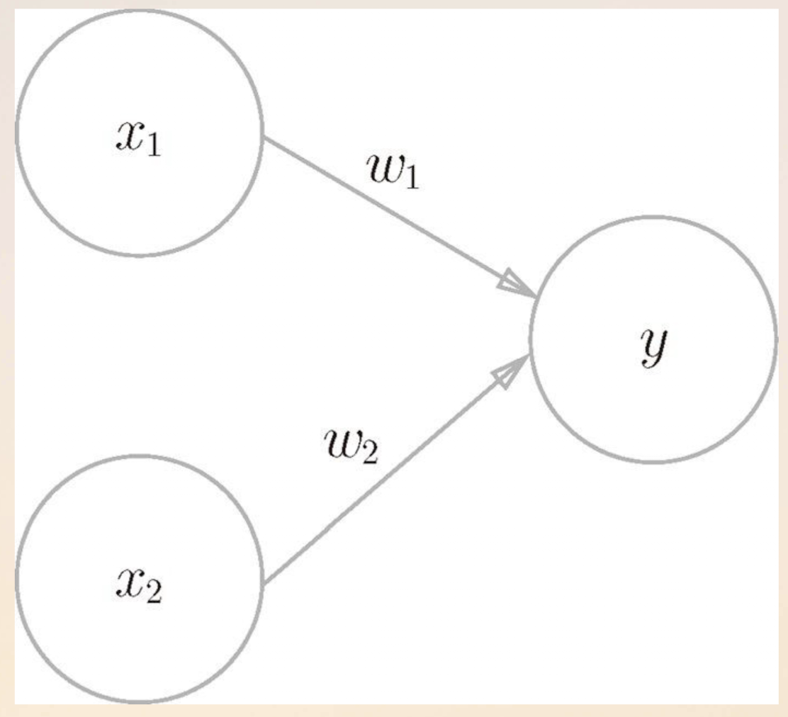
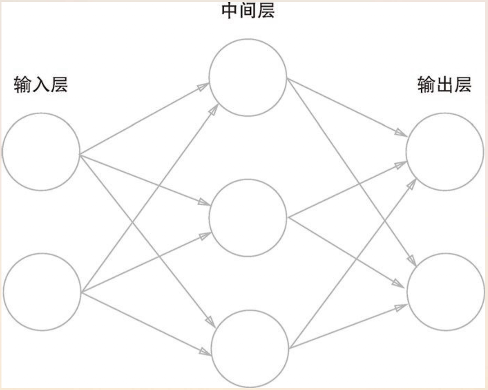
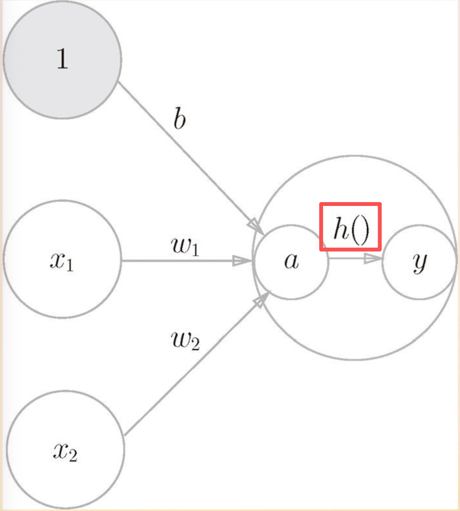
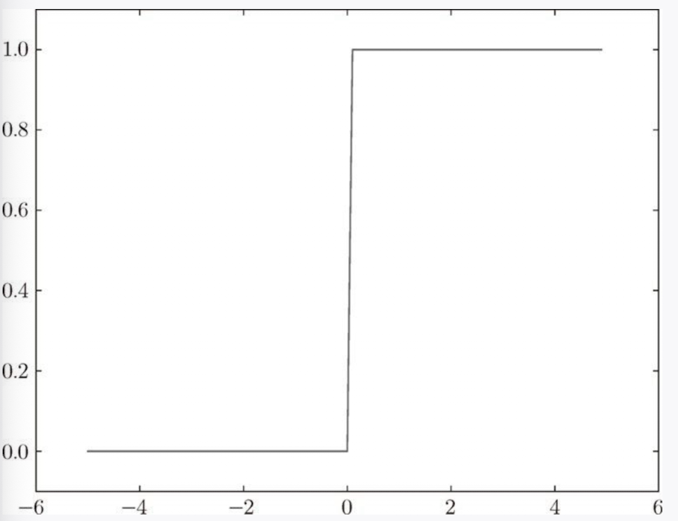

[TOC]

# 深度学习笔记
## 1 .python入门
### NumPy的使用
主要用于数据运算。是主要的计算工具。
### Matplotlib的使用
主要用于作图，更好的理解算法。
## 2. 感知机
> 引导：
> 
> 感知机是神经网路的起源算法。学习感知机的构造是通向神经网络的一种重要思想。
>
> 本章学习目标：
> 
> 简单介绍一下感知机，并用感知识解决一些简单的问题。
### 感知机是什么 -- 代码实现
1. **感知机**: 接收多个输入信号，处理多个信号后，输出一个信号的结构体。
2. **信号说明**: 感知机的信号只有1或者0两种取值，0对应不传递信号，1对应传递信号。
3. **工作原理**: 一个接收两个信号的例子。x1, x2是输入信号，y是输出信号。w1, w2是权重。图中的○称为“神经元”或者“节点”。输入信号被送往神经元，会被乘以固定的权重(w1*x1, w2*x2)。神经元会计算传送过来的信号总号，只有当这个总和超过了某个界限值时，才会输出1。这也称为”神经元被激活“。这里将这个界限值称为**阈值**θ。
<div style="width:100%; text-align:center; clear:both;">
  
</div>
公式:

$$
y=
\begin{cases}
1, & w1*x1+w2*x2>θ \\
0, & w1*x1+w2*x2\le θ 
\end{cases}
$$
感知机的多个输入信号都有各自固有的权重，这些权重发挥着控制各信号的重要性的作用。权重越大，对应权重的信号的重要性就越高。阈值代表着被激活的难易程度。

### 感知机实现简单的逻辑电路: 与门、或门、非门
#### **与门**：
门是有两个输入和一个输出的门电路。其真值表如下, 与门仅在两个输入位1时输出位1，其余都为0。
| x1 | x2 | y  |
| -- | -- | -- |
| 0  | 0  | 0  |
| 1  | 0  | 0  |
| 0  | 1  | 0  |
| 1  | 1  | 1  |

那么，用感知机如何实现与门？考虑感知机的信号不是1就是0，权重(w1, w2, θ)取值为(0.5, 0.5, 0.8)\(0.5, 0.5, 0.9)\(0.5, 0.5, 1)都可以。

#### **与非门**:
与非门就是颠倒了与门的输出。其真值表如下:
| x1 | x2 | y  |
| -- | -- | -- |
| 0  | 0  | 1  |
| 1  | 0  | 1  |
| 0  | 1  | 1  |
| 1  | 1  | 0  |

要实现与非门，权重(w1,w2,θ)取值(-0.5, -0.5, -0.7)就行，即把与门的参数值的符号取反，即可以实现与非门。

#### **或门**:
或门就只要有一个输入时1，输出就1的门电路。其真值表如下:
| x1 | x2 | y  |
| -- | -- | -- |
| 0  | 0  | 0  |
| 1  | 0  | 1  |
| 0  | 1  | 1  |
| 1  | 1  | 1  |

要实现或门，权重(w1,w2,θ)取值(0.5, 0.5, 0.3)就行，即把与门的参数值的符号取反，即可以实现与非门。


#### 代码实现:
```python
# 与门代码实现
def AND(x1, x2):
    X = np.array([x1, x2])
    W = np.array([0.5, 0.5])
    b = - 0.8
    tmp = np.sum(W*X) + b 
    if tmp > 0:
        return 1
    else:
        return 0
# (0, 0) -> 0
# (1, 0) -> 0
# (0, 1) -> 0
# (1, 1) -> 1

# 与非门代码实现
def NAND(x1, x2):
    X = np.array([x1, x2])
    W = np.array([-0.5, -0.5])
    b = 0.8
    tmp = np.sum(W*X) + b 
    if tmp > 0:
        return 1
    else:
        return 0
# (0, 0) -> 1
# (1, 0) -> 1
# (0, 1) -> 1
# (1, 1) -> 0

# 或门代码实现
def OR(x1, x2):
    X = np.array([x1, x2])
    W = np.array([0.5, 0.5])
    b = -0.3
    tmp = np.sum(W*X) + b 
    if tmp > 0:
        return 1
    else:
        return 0
# (0, 0) -> 0
# (1, 0) -> 1
# (0, 1) -> 1
# (1, 1) -> 1

```

从3个门店路的代码中也能看书，代码结构没变，变化的是参数。

#### **启发与思考**：
> 1. 通过感知机实现与门、与非门、或门3个门电路逻辑，我们可以直到，它们的感知机的构造是一样的，只是参数不同，就实现了3个门电路的逻辑。
> 
> 2. 到目前为止，参数(w1, w2, θ)的取值，是人工完成的。 

### 单层感知机的局限性
#### 局限描述
单层感知机无法表示异或门。
| x1 | x2 | y  |
| -- | -- | -- |
| 0  | 0  | 0  |
| 1  | 0  | 1  |
| 0  | 1  | 1  |
| 1  | 1  | 0  |

#### 原因分析

从将真值带入感知机线性公式：
$$ w1*0 + w2*0 = 0 $$ 
$$ w1*1 + w2*0 = 1 $$
$$ w1*0 + w2*1 = 1 $$
$$ w1*1 + w2*1 = 0 $$
得:
$$ w1 =1, w2 =1 且 w1+w2=0 不存在 $$
 

从图形中看出无法用线性表示非线性的现象:

#### 多层感知机解决该问题

用多层感知机表示非线性：
与非门 + 或门 + 与门
代码实现
```python
# 异或门代码实现

```

#### 启发与思考
> 1. 多层感知机可以处理非线性问题。
> 2. 多层感知机实际上可以实现更复杂的问题。甚至可以实现计算机。且只需要2层即可表述计算机。这里不是重点，不过多探讨。


## 3. 神经网络
> 引导：
> 
> 感知机即便是复杂的函数也能够表达，但是其确定权重的工作，`即确定合适的符合预期的输入输出的权重，还是由人工来进行。`逻辑简单只涉及1-2层时，可以由人工设定权重。问题复杂时，权重数量激增，人工要完成所有权重的设定，几乎变得不可能。
> 
> 而神经网络的出现，就刚好能解决这一问题。`神经网络的一个重要性质就是它可以自动地从数据中学习到合适的权重参数，而这个过程不需要人的介入。`
> 
> 本章学习目标：
> 
> 我们将了解神经网络的概述，然后重点关注神经网络识别时的处理。
> 

神经网络有输入层(如图最左边一层)，中间层(如图中间若干层, 因为看不见，所以也称隐藏层)，输出层(如图最右边一层)



神经网络的形状与感知机类似。神经元的连接方式与感知机并没有任何差异。那么神经网络中，信号是如何传递的呢？


### 从感知机到神经网络的过度
#### 再看感知机, 引出激活函数的概念
先来回顾下感知机, 感知机接收两个输入x1与x2, 输出f(x)，也即y。公式如下：

$$
f(x)=
\begin{cases}
1, & w1*x1+w2*x2+b>0 \\
0, & w1*x1+w2*x2+b\le 0
\end{cases}
$$

令$a=w1*x1+w2*x2+b$,代入公式整理成如下：

$$
h(a) =
\begin{cases}
1, & a>0 \\
0, & a\le 0
\end{cases}
$$

输入信号的总号会被函数h(a)转换为输出信号。h(a)这样的函数被称为**激活函数**。函数h(a)是一个分段函数，也称为阶跃函数。
##### 启发与思考 
感知机的输入信号总和 确实被一个函数作用后，再输出y了。
#### 激活函数的定义与作用
**激活函数**: 将输入信号的总和作为一个整体, 通过运算给出输出的函数。

**定义与作用**：
激活函数的作用在于决定如何来激活 输入信号的总和，即 输入信号的总和作为一个整体，再被带入到激活函数中，去输出新的值。即最重要的是 怎么激活(运算)

输入信号(x1, x2)与权重(w1,w2)和偏置b进行了加权总和后，记为a。h()函数将a转换成为输出y。**h()函数中的运算逻辑是重点**。下图中展示了激活函数的作用过程。



##### 启发与思考
可见单层感知机，也有激活函数的概念。

#### 激活函数是连接感知机和神经网络的桥梁

> “感知机”没有严格统一它所指的算法。一般而言：
> 
> “朴素感知机”是指单层网络，指的是激活函数使用了**阶跃函数** 的模型。
> 
> "多层感知机“是指神经网络，指的是激活函数使用了**sigmoid函数** 等平滑的激活函数的多层网络。
##### 启发与思考
可见神经网络的两个明显特点: 多层、使用了平滑的激活函数。
### 激活函数：
##### 阶跃函数

$$
h(a) =
\begin{cases}
1, & a>0 \\
0, & a\le 0
\end{cases}
$$



阶跃函数代码实现：

```python
def step_function(x): # 参数x只能接受实数
    if x>0:
        return 1
    else:
        return 0

def stip_function(x): # 参数x支持numpy数组
    y = x > 0
    return y.astype(np.int_)
```


##### sigmoid函数:

$$
\sigma(x) = \frac{1}{1 + e^{-x}}
$$


1. 激活函数必须是非线性函数。
2. 阶跃函数、sigmoid函数都为非线性函数。阶跃函数像竹筒敲石头，只做是否传送水(0或1)两个动作；sigmoid函数像水车一样，根据流过来的水量响应地调整传出去的数量。


### 3 层神经网络的实现
### 输出层的设计- softmax函数 直出函数 

## 4. 神经网络的学习 -- 发生在神经网络中的学习


  
