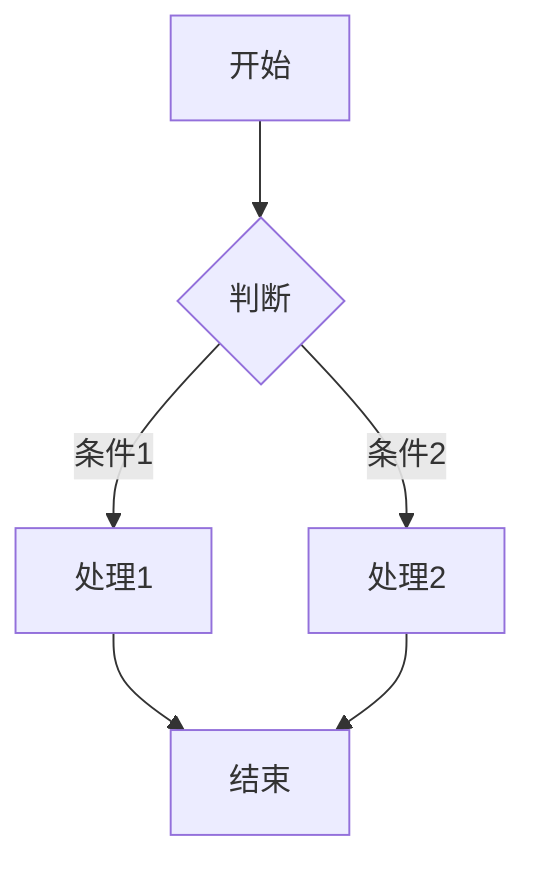

# markdown学习笔记

> "Markdown是一种轻量级标记语言，让你专注于写作本身。"


[TOC]
### Markdown 是什么？
> **Markdown是一种 *轻量级* *标记语言*。** 它主要任务是告诉前端如何渲染文本的结构和内容。
> 
> **标记语言**：本身也是纯文本，由符号和字符组成。`因为标记语言的组成原始，所以能输入输出纯文本的设备几乎都支持Markdown。`
> 
> **轻量级**主要表现为：
> 1. 标记本身是纯文本，只要在写作内容上添加少量标记就能控制内容的结构和样式；
> 2. 标记的语法简单，记住常用的就十几种标记就能完成90%以上的写作编排。
> 
> 当文本的结构和样式简单了，就能专注在写作本身了。

>Markdown有两种状态，`编辑状态`和`预览状态`。
>**编辑状态**: Markdown本身是一份纯文本，其中包含标记和文本内容，编辑状态看到的就Markdown最初的状态，即标记和文本内容。
>**预览状态**：Markdown中的标记被解析器后，标记被翻译成排版效果。即标记符号隐藏，只展示渲染后的内容


### 为什么要用Markdown
1. Markdown 无处不在。StackOverflow、CSDN、掘金、简书、GitBook、有道云笔记、V2EX、光谷社区等。主流的代码托管平台，如 GitHub、GitLab、BitBucket、Coding、Gitee 等等，都支持 Markdown 语法，很多开源项目的 README、开发文档、帮助文档、Wiki 等都用 Markdown 写作。
2. Markdown 本身就是纯文本。它一纯文本来编排文本。语法简单，与文本内容编辑在一起编辑。这使得它完全不依赖任何编辑应用或者系统平台。只要能读纯文本，Markdown文件也能读。这就保证了markdown永不过时，不会被编辑器和平台绑架。
3. Markdown 不仅人读起来结构清晰，理解起来简单，大模型读起来也简单。它能根据标记在语义上读懂哪里是主标题、哪里是副标题、哪里是重点、哪里是列表、哪里是正文。对大模型的理解非常友好。
4. Markdown 做笔记后，可以转为PDF、word、PPT。

### Markdown基础语法


#### 1. 标题
```
这里只写出编辑状态下的标记：
# 标题1
## 标题2
### 标题3 
#### 标题4
##### 标题5
###### 标题6
```
#### 2. 引用
> "Markdown是一种轻量级标记语言，让你专业与写作本身。"

#### 3. 目录
```
这里只写出编辑状态下的标记：
将[TOC] 添加到文章最上面，将自动识别标题标记，从而形成目录
```

#### 4. 粗体、斜体、删除线、高亮、行内代码、代码块
**粗体**
*斜体*
~~删除线~~
==高亮==
`import os`  

#### 5. 代码块
```python
import datetime
print("hello world")
```
#### 6. 无序列表、有序列表、任务清单
- 无序列表1
- 无序列表2
- 无序列表3
1. 有序列表1
2. 有序列表2
3. 有序列表3
- [] 任务一
- [x] 任务二

#### 7. 表格
|功能|状态|说明|
|--|--|--|
|实时预览|✅|左侧标记右侧渲染|
|自动保存|✅|localStorage存储|
|导出文件|✅|支持Markdown/HTML|

#### 8. 注脚
这里有一个注脚[^1].
[^1]: 我是解释这个注脚的内容.    -->这行虽然没有写在md的页为，但是会出现在渲染后的页尾

#### 9. 数学公式(不同编辑器，解析的效果不同)
行内公式: $E=mc^2$
块级公式:
$$
\int_{a}^{b} f(x) \, dx = F(b) - F(a)
$$

#### 10. Mermaid图表


#### 11. 提示框(不同编辑器，解析的效果不同)
> [!INFO]

> [!WARNING]

#### 12. 分割线
---


#### 13. 链接
创建链接的两种方式：行内式 和 参考式

行内式：
```markdown
[文字描述](实际要跳转的url) 
```
效果：[Markdown基本语法](https://github.com/younghz/Markdown "Markdown")

参考式：
```markdown
[文字描述][1]

[1]:[实际要跳转的url]  --> 本行与上一行必须间隔一行，这样语法才生效。虽然这行写了，但是渲染后的markdown页面上不会有这一行。
```
效果：[Markdown基本语法][1]

[1]:https://github.com/younghz/markdown


#### 14. 需要转义的字符
```markdown
\\ 反斜杠
\` 反引号
\* 星号
\_ 下划线
\{\} 大括号
\[\] 中括号
\(\) 小括号
\# 井号
\+ 加号
\- 减号
\. 英文句号
\! 感叹号
```


