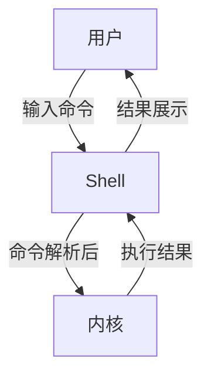

# Shell
### Shell什么是?
**Shell 是操作系统内核和用户之间的 “命令解释器”**，一层中间程序。
你在终端里敲的文字命令，不是直接交给 macOS 内核，而是先交给 Shell，由 Shell 翻译、传给内核，内核执行完再把结果返回给 Shell，展示到终端(这里用的是iTerm2)。


### 运行shell命令
|命令|操作|备注|
|--|--|--|
|cd|进入到目录下|cd ~/path/to/destination|
|ls|列出该目录下的显示文件|ls ~/path/to/directory|
|ls|列出该目录下的显示和隐示的文件清单|ls -al ~/path/to/directory|
|mv|修改文件名称|mv old.txt new.txt ->将文件名old.txt改成new.txt|
|mv|移动文件|mv ~/path/to/source/markdown.md ~/path/to/destination -->将源文件移动到目标目录|
|mv|移动文件|mv markdown.md todo.md vim.md ~/path/to/destination ->当前目录下多个文件移动到目标目录下|
|mkdir|创建文件夹,上层目录必须已存在|mkdir ~/path/to/destination/louis1|
|mkdir|创建文件夹,上层目录不存在就先补建|mkdir -p louis2/louis3 -> 当前目录下，文件夹louis2如果不存在，先创建louis2再在其中创建louis3文件夹|
|ln|创建硬链接|ln a.txt b.txt -> 同一文件的多个名字，共享 inode|
|ln|创建软链接|ln -s ~/dotfiles/to/nvim ~/.config/nvim ->创建 dotfiles/to/nvim目录的快捷入口。ln -s可以针对目录或者文件创建快捷入口|
|history|查看历史执行命令|history -> 查看历史上执行的命令|
|history|查看历史执行命令|history \| grep aerospace -> 查看历史上执行的包含aerospace的命令|

### 输入命令过程中
|操作键|操作说明|
|---|---|
|`ctrl+a` |光标移动到最左端|
|`ctrl+e` |光标移动到最右端|
|`ctrl+w`|删除光标左侧单词|
|`ctrl+u` |删除光标左侧|
|`ctrl+k` |删除光标右侧|

### 为什么有这么多shell？
> 最早只有一个 sh，后来大家觉得它不够用、想要不同特性，于是分叉、重写，诞生了各种 Shell；它们目标不一样，有的求稳定，有的求好用，有的追求新潮。总得来说，Shell有两大用途，侧重点天然矛盾：
>- ✅ **交互使用（人敲命令）**：要好看、智能补全、历史、别名、主题、快捷键，舒服最重要（zsh/fish) -- `但这不稳定、重、慢`
>- ✅ **执行脚本（机器自动跑）**：要标准、稳定、跨平台兼容、轻量、速度快（sh /dash/bash） -- `但这没以上交互便利`
>
>没有一个 shell 能完美同时做到所有，所以分化了。

### 历史中有哪些Shell?
1. **sh（Bourne Shell，1979）**
Unix最初的标准shell，基础能力：`执行命令、简单脚本`。
缺点：交互体验很差，没有命令历史、Tab 补全、别名，只适合跑脚本。
2. **csh（C Shell）**
语法模仿C语言，增加了交互功能（历史、别名）。
缺点：脚本语法和sh不兼容，写脚本容易踩坑。
3. **bash（Bourne-Again Shell）**
GNU项目，`兼容sh的脚本语法`，同时`吸收csh的交互优点`。Linux 默认 shell 几十年，`生态极大，兼容性无敌`。
缺点：设计比较老，代码臃肿，一些交互特性做得一般。
4. **zsh（Z Shell）**
在bash基础上继续扩展，`补全更强、主题丰富、配置灵活`。
`macOS 从 Catalina 开始默认换成 zsh`，**脚本层面尽量兼容bash，交互体验大幅升级。**
缺点：性能慢一些，整体显得重一些。
5. **fish（Friendly Interactive Shell）**
重新设计shell，开箱即用：自动提示、语法高亮、人性化补全，不用折腾 oh-my-zsh 这类框架。
缺点：`不兼容 sh/bash 语法`。
6. 还有小众：ksh、dash
dash：精简版 sh，速度极快，Ubuntu 系统脚本默认用它，
缺点：`专门跑脚本，不适合人交互输入`。


### 现在Shell怎么选？选zsh!
选用zsh。理由有三：
1. 补全功能强大：路径、git分支、命令、参数、写代码都能补全
2. 高度自定义：别名、参数、状态显示栏(git分支、python环境、路径)、主题
3. 兼容bash语法：网上绝大多数Shell脚本，一键部署，直接复制跑

fish虽然交互体验也好，自带高亮、智能提示，开箱即用。但无法满足作为程序员需要经常跑脚本、Shell命令，直接粘贴跑Shell大概率报错。


# zsh

功能学习:


# oh-my-zsh
> 刚开始接触oh-my-zsh，是因为其炫酷的主题。

```
# If you come from bash you might have to change your $PATH.
# export PATH=$HOME/bin:/usr/local/bin:$PATH

# Path to your oh-my-zsh installation.
export ZSH=$HOME/.oh-my-zsh

# Set name of the theme to load --- if set to "random", it will
# load a random theme each time oh-my-zsh is loaded, in which case,
# to know which specific one was loaded, run: echo $RANDOM_THEME
# See https://github.com/ohmyzsh/ohmyzsh/wiki/Themes
# ZSH_THEME=random
ZSH_THEME="amuse"

# Set list of themes to pick from when loading at random
# Setting this variable when ZSH_THEME=random will cause zsh to load
# a theme from this variable instead of looking in $ZSH/themes/
# If set to an empty array, this variable will have no effect.
# ZSH_THEME_RANDOM_CANDIDATES=( "robbyrussell" "agnoster" "amuse"	"afowler" "apple" "arrow" "bira" "candy" "fino-time" "intheloop" "jispwoso" "josh" "jonathan" "mortalscumbag" "simonoff" "smt" "strug" "xiong-chiamiov" "xiong-chiamiov-plus" "ys")

# Uncomment the following line to use case-sensitive completion.
# CASE_SENSITIVE="true"

# Uncomment the following line to use hyphen-insensitive completion.
# Case-sensitive completion must be off. _ and - will be interchangeable.
# HYPHEN_INSENSITIVE="true"

# Uncomment the following line to disable bi-weekly auto-update checks.
DISABLE_AUTO_UPDATE="true"

# Uncomment the following line to automatically update without prompting.
# DISABLE_UPDATE_PROMPT="true"

# Uncomment the following line to change how often to auto-update (in days).
# export UPDATE_ZSH_DAYS=13

# Uncomment the following line if pasting URLs and other text is messed up.
# DISABLE_MAGIC_FUNCTIONS="true"

# Uncomment the following line to disable colors in ls.
# DISABLE_LS_COLORS="true"

# Uncomment the following line to disable auto-setting terminal title.
# DISABLE_AUTO_TITLE="true"

# Uncomment the following line to enable command auto-correction.
# ENABLE_CORRECTION="true"

# Uncomment the following line to display red dots whilst waiting for completion.
# Caution: this setting can cause issues with multiline prompts (zsh 5.7.1 and newer seem to work)
# See https://github.com/ohmyzsh/ohmyzsh/issues/5765
# COMPLETION_WAITING_DOTS="true"

# Uncomment the following line if you want to disable marking untracked files
# under VCS as dirty. This makes repository status check for large repositories
# much, much faster.
# DISABLE_UNTRACKED_FILES_DIRTY="true"

# Uncomment the following line if you want to change the command execution time
# stamp shown in the history command output.
# You can set one of the optional three formats:
# "mm/dd/yyyy"|"dd.mm.yyyy"|"yyyy-mm-dd"
# or set a custom format using the strftime function format specifications,
# see 'man strftime' for details.
# HIST_STAMPS="mm/dd/yyyy"

# Would you like to use another custom folder than $ZSH/custom?
# ZSH_CUSTOM=/path/to/new-custom-folder

# Which plugins would you like to load?
# Standard plugins can be found in $ZSH/plugins/
# Custom plugins may be added to $ZSH_CUSTOM/plugins/
# Example format: plugins=(rails git textmate ruby lighthouse)
# Add wisely, as too many plugins slow down shell startup.
plugins=(git zsh-autosuggestions zsh-syntax-highlighting)

source $ZSH/oh-my-zsh.sh

# User configuration

# export MANPATH="/usr/local/man:$MANPATH"

# You may need to manually set your language environment
# export LANG=en_US.UTF-8

# Preferred editor for local and remote sessions
# if [[ -n $SSH_CONNECTION ]]; then
#   export EDITOR='vim'
# else
#   export EDITOR='mvim'
# fi

# Compilation flags
# export ARCHFLAGS="-arch x86_64"

# Set personal aliases, overriding those provided by oh-my-zsh libs,
# plugins, and themes. Aliases can be placed here, though oh-my-zsh
# users are encouraged to define aliases within the ZSH_CUSTOM folder.
# For a full list of active aliases, run `alias`.
#
# Example aliases
# alias zshconfig="mate ~/.zshrc"
# alias ohmyzsh="mate ~/.oh-my-zsh"
source ~/.oh-my-zsh/custom/plugins/zsh-syntax-highlighting/zsh-syntax-highlighting.zsh
DEFAULT_USER=shaoye

alias myserver="ssh -i /Users/shaoye/Documents/louis_wu_server.pem root@106.52.206.213"


# some vars about pyenv and pyenv-virtualenv
# export PATH="$HOME/.pyenv/bin:$PATH"
eval "$(pyenv init -)"
eval "$(pyenv virtualenv-init -)"

# vars about 
export PATH="$HOME/.local/bin:$PATH"

alias python="python3"
alias pip="pip3"
alias learn_env="pyenv activate 3.9.1/envs/learning_env"
alias nobase="cd ~/knowledge-base"


# Add this var for Pudb.
# export PYTHONBREAKPOINT="pudb.set_trace"

# >>> conda initialize >>>
# !! Contents within this block are managed by 'conda init' !!
__conda_setup="$('/Users/shaoye/anaconda3/bin/conda' 'shell.zsh' 'hook' 2> /dev/null)"
if [ $? -eq 0 ]; then
    eval "$__conda_setup"
else
    if [ -f "/Users/shaoye/anaconda3/etc/profile.d/conda.sh" ]; then
        . "/Users/shaoye/anaconda3/etc/profile.d/conda.sh"
    else
        export PATH="/Users/shaoye/anaconda3/bin:$PATH"
    fi
fi
unset __conda_setup
# <<< conda initialize <<<
```
